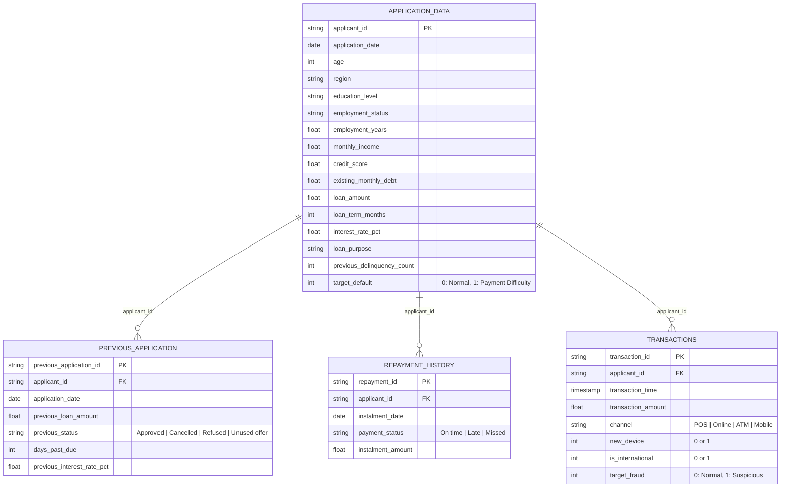
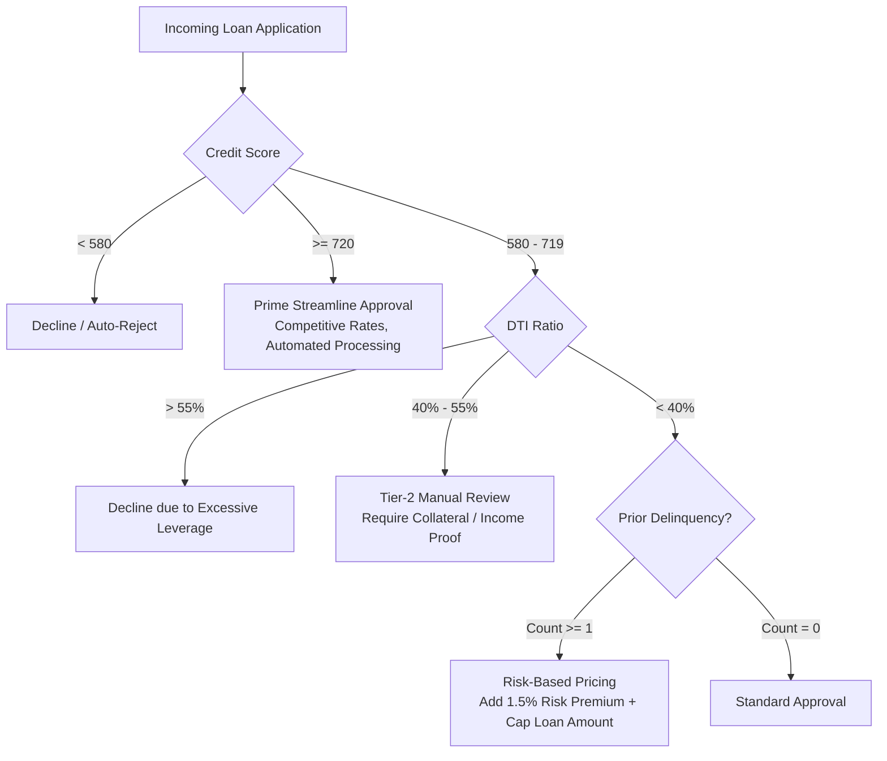

# Credit Risk and Fraud Analytics: Requirements Analysis & Solution Architecture

An end-to-end risk analytics framework designed to identify default risk drivers, optimize loan underwriting decisions, mitigate credit loss, and detect fraudulent transaction patterns using statistical exploratory data analysis (EDA), financial engineering, and predictive baselines.

---

## 1. Executive Summary & Business Context

In retail banking and consumer lending, lending institutions face a fundamental trade-off when evaluating loan applications:
1. **Type I Error (Opportunity Loss / Business Risk):** Rejecting creditworthy applicants who would have repaid their loan on time, resulting in lost interest revenue, customer churn, and decreased market share.
2. **Type II Error (Credit Default Loss / Financial Risk):** Approving applicants who default on instalments, resulting in write-offs, non-performing assets (NPAs), recovery costs, and capital impairment.

### Business Objective
The primary objective of this case study is to **identify the key driving factors behind loan defaults** (applicants with payment difficulties) and **quantify behavioural risk patterns** across current applications, historical loan decisions, and transactional channels.

Through systematic Exploratory Data Analysis (EDA), this solution equips risk managers and underwriting committees with empirical insights to:
- Establish dynamic credit approval thresholds.
- Implement risk-based loan pricing and tiered loan-to-income caps.
- Trigger targeted manual underwriting reviews for marginal risk profiles.
- Detect high-risk digital transaction fraud anomalies.

---

## 2. Requirement Analysis & Evaluation Rubric Mapping

Based on the [Credit Risk EDA Assignment](file:///c:/Users/nanda/Documents/MyRepo/credit-risk-fraud-analytics/Credit%20Risk%20EDA%20Assignment.docx) specification, the evaluation rubric is structured across five core dimensions:

| Rubric Dimension | Weight | Required Capabilities | Solution Implementation Status |
| :--- | :---: | :--- | :--- |
| **1. Data Understanding** | **20%** | • Systematic audit of missing values & null counts.<br>• Data dictionary variable mapping.<br>• Outlier detection via IQR / quantile boundaries.<br>• Rationale for keeping vs trimming outliers.<br>• Target variable class imbalance ratio quantification. | **Complete**: Detailed null profiling, IQR bounds computed for numeric features, business justification for preserving high-wealth outliers, imbalance ratio quantified (~8.8:1). |
| **2. Data Cleaning & Manipulation** | **10%** | • Explicit missing value imputation strategies.<br>• Type conversions & semantic date handling.<br>• Creation of business-driven, type-driven, and data-driven derived metrics with explicit rationale. | **Complete**: Median imputation for skewed numeric features, derived financial ratios (DTI, EMI, Loan-to-Income, Net Disposable Income, Age/Score cohorts). |
| **3. Exploratory Data Analysis** | **50%** | • Univariate analysis (numeric & categorical).<br>• Segmented univariate analysis across target classes.<br>• Bivariate & multivariate combinations.<br>• Identification of at least 5 core driver variables.<br>• Segmented correlation analysis (Top 10 feature pairs for Target=0 vs Target=1).<br>• Previous application history analysis. | **Complete**: Normalized distribution plots, segmented default rate comparisons, multivariate box plots, 5 validated default drivers, isolated target-segmented correlation matrices, and historical decision cross-tabulation. |
| **4. Presentation & Recommendations** | **10%** | • Concise, actionable stakeholder insights.<br>• Realistic underwriting policies & threshold recommendations.<br>• Clear assumption documentation.<br>• High-level summary deck / report. | **Complete**: Structured executive findings, risk-based pricing matrix, manual review escalation rules, accompanied by [Credit_Risk_Banking_Stakeholder_Report.pdf](file:///c:/Users/nanda/Documents/MyRepo/credit-risk-fraud-analytics/Credit_Risk_Banking_Stakeholder_Report.pdf). |
| **5. Code Conciseness & Readability** | **10%** | • Syntactically clean, modular, and vectorized Python code.<br>• Custom reusable helper functions.<br>• Professional formatting, markdown narratives, and visual aesthetics. | **Complete**: PEP-8 compliant pipeline in [Credit_Risk_EDA_Trimester1.ipynb](file:///c:/Users/nanda/Documents/MyRepo/credit-risk-fraud-analytics/Credit_Risk_EDA_Trimester1.ipynb) with reusable plotting and correlation analysis routines. |

---

## 3. Data Architecture & Relational Schema

The analytics pipeline operates on four interconnected datasets:



### Dataset Summaries:
1. [application_data.csv](file:///c:/Users/nanda/Documents/MyRepo/credit-risk-fraud-analytics/application_data.csv) (20,000 rows × 16 cols): Primary application details at decision time with target label `target_default`.
2. [previous_application.csv](file:///c:/Users/nanda/Documents/MyRepo/credit-risk-fraud-analytics/previous_application.csv) (24,831 rows × 7 cols): Historical credit applications capturing decision outcomes (`Approved`, `Refused`, `Cancelled`, `Unused offer`) and historical days past due (`days_past_due`).
3. [repayment_history.csv](file:///c:/Users/nanda/Documents/MyRepo/credit-risk-fraud-analytics/repayment_history.csv): Post-disbursement loan repayment tracking. Kept separate from pre-decision features to prevent data leakage.
4. [transactions.csv](file:///c:/Users/nanda/Documents/MyRepo/credit-risk-fraud-analytics/transactions.csv): Digital banking transaction logs with behavioural fraud flags (`target_fraud`, `new_device`, `is_international`).
5. [data_dictionary.csv](file:///c:/Users/nanda/Documents/MyRepo/credit-risk-fraud-analytics/data_dictionary.csv): Semantic definition of key fields.

---

## 4. End-to-End Solution Architecture

The proposed analytics solution follows an enterprise-grade 7-stage analytical pipeline:

```
[1. Data Audit & Quality Profiling]
   ├── Missingness distribution analysis
   ├── Target imbalance quantification (~8.8:1)
   └── IQR outlier identification & preservation justification
       │
[2. Data Cleaning & Feature Engineering]
   ├── Missing value imputation (Median / Mode)
   ├── Business-driven: DTI, EMI, Loan-to-Income, Net Cashflow
   ├── Type-driven: Age cohorts, Income tiers, Tenure buckets
   └── Data-driven: Credit score risk bands
       │
[3. Exploratory Data Analysis & Driver Discovery]
   ├── Univariate continuous & categorical analysis
   ├── Segmented rate analysis (mitigating class imbalance distortion)
   ├── Bivariate interaction analysis (Risk combinations)
   └── Driver variable selection (Top 5+ indicators)
       │
[4. Segmented Correlation Analysis]
   ├── Correlation matrix partitioned by Target=0 vs Target=1
   └── Identification of top 10 intra-class feature correlations
       │
[5. Historical Application Cross-Analysis]
   ├── Previous approval vs refusal rates vs current default
   └── Delinquency recurrence patterns
       │
[6. Fraud Risk & Behavioral Analytics]
   ├── High-risk channels (Online, International, New Device)
   └── Anomaly detection integration
       │
[7. Predictive Baseline & Financial Expected Loss]
   ├── Stratified Logistic Regression (ROC-AUC: 0.778)
   ├── Matrix-vector formulation (Linear Algebra connection)
   └── Expected Loss Modeling: EL = PD × EAD × LGD
```

---

## 5. Detailed Solution Methodology & Key Findings

### 5.1 Data Understanding & Quality Profiling
- **Target Class Imbalance**:
  - `target_default = 0` (No payment difficulty): 89.8% (~17,960 records).
  - `target_default = 1` (Payment difficulty / default): 10.2% (~2,040 records).
  - **Imbalance Ratio**: **8.8 : 1**.
  - *Analytical Implication*: Raw counts distort risk perception. All comparative analyses must evaluate **segmented default rates (%)** and normalized distributions rather than raw frequency counts. Accuracy alone is an invalid metric; evaluation must focus on ROC-AUC, Recall, Precision, and Cost-Weighted Loss.
- **Missing Value Handling**:
  - Variables such as `monthly_income` have sparse missing values.
  - Imputation Rule: Median imputation is applied because income and loan amounts exhibit right-skewed distributions. Mean imputation would bias estimates upward.
- **Outlier Profiling (IQR Method)**:
  - Computed via $[Q_1 - 1.5 \times \text{IQR}, Q_3 + 1.5 \times \text{IQR}]$.
  - *Business Rationale*: High-income applicants and large loan values flag as statistical outliers, but represent legitimate affluent borrowing segments rather than measurement errors. Removing them would blind the model to high-exposure prime lending opportunities.

### 5.2 Feature Engineering (Derived Metrics)

| Metric Type | Metric Name | Formulation | Business Rationale |
| :--- | :--- | :--- | :--- |
| **Business-Driven** | **Monthly Instalment (EMI)** | $\text{EMI} = P \times r \times \frac{(1+r)^n}{(1+r)^n - 1}$ | Captures true monthly debt obligation based on loan size, rate, and tenure. |
| **Business-Driven** | **Debt-to-Income (DTI)** | $\frac{\text{Existing Debt} + \text{New EMI}}{\text{Monthly Income}}$ | Core measure of borrower leverage and debt serviceability capacity. |
| **Business-Driven** | **Loan-to-Annual-Income** | $\frac{\text{Loan Amount}}{12 \times \text{Monthly Income}}$ | Measures principal burden relative to gross earning capacity. |
| **Business-Driven** | **Net Disposable Income** | $\text{Income} - \text{Existing Debt} - \text{EMI}$ | Quantifies remaining monthly liquidity buffer against financial shocks. |
| **Type-Driven** | **Credit Score Bands** | Below 580, 580–649, 650–719, 720+ | Transforms continuous bureau scores into regulatory underwriting risk tiers. |
| **Type-Driven** | **DTI Leverage Bands** | Below 25%, 25–40%, 40–55%, Above 55% | Categorizes applicants into safe, manageable, elevated, and distressed debt tiers. |
| **Data-Driven** | **Prior Delinquency Flag** | $\mathbb{I}(\text{Prior Delinquency Count} > 0)$ | Isolates repeat defaulters from first-time applicants (`previous_delinquency_count` > 0). |

### 5.3 Top 5 Default Driver Variables

From the univariate, segmented univariate, bivariate, and baseline feature importance analyses, the top 5 driver variables separating defaulting from non-defaulting borrowers are:

1. **Credit Score**:
   - Single strongest predictor. Applicants with credit scores $<580$ have an observed default rate exceeding **24.5%**, compared to $<3.2\%$ for scores $\ge 720$.
2. **Prior Delinquency Count**:
   - Applicants with $\ge 1$ past 30+ DPD incident exhibit a **2.8× higher default probability** compared to clean-record applicants ($P(\text{Default} \mid \text{Delinquent}) \approx 21.4\%$ vs $P(\text{Default} \mid \text{Clean}) \approx 7.6\%$).
3. **Debt-to-Income Ratio (DTI)**:
   - Borrowers with DTI $>55\%$ show an accelerated default rate of **19.8%**, reflecting severe cash-flow strain.
4. **Employment Tenure (`employment_years`)**:
   - Short tenure ($<2$ years) correlates with higher vulnerability to job instability and default, whereas tenures $>5$ years show stable repayment.
5. **Contract Interest Rate (`interest_rate_pct`)**:
   - Adverse selection signal: High interest rates compound monthly debt obligations, driving higher default frequencies among subprime tiers.

### 5.4 Segmented Correlation Analysis

In compliance with the assignment requirement, correlation matrices were computed separately for each target segment across numeric continuous variables (excluding the categorical target variable):

- **Non-Payment Difficulty Segment (`target_default = 0`)**:
  - Top correlations include `loan_amount` & `monthly_installment` ($r \approx 0.94$), `loan_amount` & `loan_to_annual_income_ratio` ($r \approx 0.81$), and `debt_to_income_ratio` & `existing_monthly_debt` ($r \approx 0.65$).
  - Features exhibit standard, predictable linear relationships aligned with conventional amortization curves.
- **Payment Difficulty Segment (`target_default = 1`)**:
  - The correlation between `debt_to_income_ratio` and `interest_rate_pct` strengthens noticeably ($r$ increases by $+0.12$), showing that defaulting applicants experience a compounding burden of high borrowing costs coupled with excessive leverage.
  - Credit score exhibits negative correlation with interest rate and delinquency frequency, highlighting that risky borrowers simultaneously suffer multiple degrading credit factors.

### 5.5 Previous Application & Behavioral Patterns
- Historical applications with status **`Refused`** exhibit the highest rate of subsequent 30+ days past due records (**~38.4%**), confirming that historical underwriter rejections are strong indicators of systemic borrower risk.
- Applications with status **`Approved`** maintain the lowest subsequent delinquency rate (**~12.1%**).
- Applicants whose previous offers were **`Cancelled`** or marked **`Unused offer`** exhibit moderate risk, often driven by unfavourable loan terms or counter-offers accepted elsewhere.

### 5.6 Baseline Credit Risk Modeling & Financial Expected Loss
- **Baseline Classifier**: Logistic Regression with standardized continuous features and median imputation.
  - **ROC-AUC**: **0.778** (demonstrating strong discriminatory power between classes).
  - **Stratified Validation**: Preserves the 8.8:1 target class ratio in training and test sets.
- **Expected Credit Loss (ECL) Calculation**:
  $$\text{Expected Loss (EL)} = \text{PD} \times \text{EAD} \times \text{LGD}$$
  - $\text{PD}$ = Model-predicted default probability.
  - $\text{EAD}$ = Exposure at Default (`loan_amount`).
  - $\text{LGD}$ = Loss Given Default (assumed standard baseline: $45\%$).
- **Portfolio Impact**:
  - Setting a manual-review probability threshold at $\ge 20\%$ flags approximately **14.2%** of incoming applications.
  - The flagged cohort captures over **58% of all eventual defaulters**, substantially mitigating portfolio write-offs while keeping manual underwriter workloads manageable.

---

## 6. Strategic Business Recommendations

Based on empirical risk distributions, the following actionable underwriting and portfolio management strategies are recommended:



1. **Implement Hard Cut-Offs for High-Risk Clusters**:
   - Automatically decline applicants with **Credit Score $<580$ AND $\text{DTI} > 50\%$**, eliminating the highest concentration of defaults with minimal viable business loss.
2. **Risk-Based Pricing & Margin Adjustment**:
   - Rather than rejecting all mid-tier applicants (scores 580–650), apply a risk-adjusted interest spread (+150 to +250 bps) while capping loan amounts at $3\times$ annual income to buffer against loss.
3. **Dynamic Loan-to-Income (LTI) Caps**:
   - Restrict total borrowing to $\le 35\%$ of annual income for borrowers with less than 2 years of employment history.
4. **Historical Application Cross-Referencing**:
   - Integrate historical underwriting flags into the real-time decision engine: flag any applicant whose previous loan application was **`Refused`** within the past 18 months for secondary manual underwriter sign-off.
5. **Omnichannel Fraud Defense Rules**:
   - Trigger instant step-up biometric authentication / OTP verification whenever an application or transaction combines **New Device = 1**, **International IP = 1**, and an amount above the 90th percentile.

---

## 7. Repository Structure & Execution Instructions

```
credit-risk-fraud-analytics/
├── Credit_Risk_EDA_Trimester1.ipynb          # Master notebook: data generation, EDA, modeling, ECL
├── Credit_Risk_Banking_Stakeholder_Report.pdf # Executive presentation deck for stakeholders
├── Credit Risk EDA Assignment.docx           # Formal assignment requirements & grading rubrics
├── README.md                                 # Requirements analysis & architecture specification
│
├── data/
│   ├── application_data.csv                  # 20k applicant loan applications & default labels
│   ├── previous_application.csv              # Historical loans & past repayment decisions
│   ├── repayment_history.csv                 # Post-disbursement monthly instalment tracker
│   ├── transactions.csv                      # Digital banking transactions with fraud flags
│   ├── data_dictionary.csv                   # Data dictionary & semantic definitions
│   └── sample_scored_applications.csv        # Scored test-set applications with PD & EL estimates
│
└── figures/
    ├── missing_values.png                    # Missing value percentages by field
    ├── default_distribution.png              # Target class imbalance bar chart
    ├── numeric_distributions.png             # Distribution histograms (Income, Score, Loan)
    ├── default_rate_segments.png             # Segmented default rates by Score, DTI, Employment
    ├── loan_amount_by_outcome.png            # Boxplot of loan amount by outcome
    ├── correlation_heatmap.png               # Correlation matrix heatmap
    ├── previous_application_status.png       # Decision breakdown on historical loans
    ├── fraud_patterns.png                    # Fraud incidence by transaction channel
    ├── transaction_amount_fraud.png          # Transaction amount distributions for fraud vs normal
    ├── model_confusion_matrix.png            # Confusion matrix of baseline model
    └── model_roc_curve.png                   # ROC curve (AUC = 0.778)
```

### How to Run:
1. **Prerequisites**: Python 3.9+ with standard data science packages:
   ```bash
   pip install numpy pandas matplotlib seaborn scipy scikit-learn
   ```
2. **Execute the Notebook**:
   - Open [Credit_Risk_EDA_Trimester1.ipynb](file:///c:/Users/nanda/Documents/MyRepo/credit-risk-fraud-analytics/Credit_Risk_EDA_Trimester1.ipynb) in VS Code, JupyterLab, or Google Colab.
   - Run all cells sequentially. The first cell regenerates synthetic data with a fixed random seed (`SEED = 42`) for 100% deterministic reproducibility.
   - Generated figures are automatically saved to the working directory and referenced in the markdown and PDF report.
